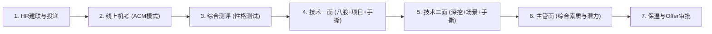

# 大三备战华为实习：算法突围与面试通关全攻略

大三上学期（11 月—次年 2 月）收到华为 HR 的业务介绍电话是一个**非常积极的信号**——这意味着你的院校/专业背景已进入目标部门的人才池，部门正在为**寒假日常实习**或明年 3 月正式开启的**春招暑期实习**提前摸底、锁人。

针对你目前担心的“机考和面试算法题”，本指南将帮你彻底厘清华为的考核逻辑，并提供一套可落地的 **6 周能力跃迁方案**。

---

## 一、 知己知彼：华为实习招聘全流程与核心关卡

华为研发类实习生的选拔流程非常标准化，算法能力贯穿**线上机考**与**两轮技术面**，但两者的考察侧重点截然不同：



### 1. 第一关：线上机考（决定能否进面）
* **考试形式**：依托牛客网或华为自研平台，时长 **120～150 分钟**，共 **3 道编程题**。
* **分值与过线机制**：总分 **600 分**（梯度为 `100 分 + 200 分 + 300 分`），常规合格线为 **150 分**。但分数越高，后续部门捞人优先级、面试印象分以及未来转正定级越占优势（建议目标定在 **300 分以上**）。
* **按通过率给分（关键策略）**：每道题后台有几十个测试用例，**过多少比例的用例拿多少比例的分**！哪怕第 3 题（300 分）想不出动态规划最优解，写一个回溯暴力搜索或特殊情况分支通过 40% 用例，也能稳拿 120 分。
* **核心痛点——ACM 模式**：力扣（LeetCode）默认是“核心代码模式”（只需补全函数），而华为机考是 **ACM 模式**——你必须自己引入头文件、写主函数、从标准输入（`stdin`）解析多行字符串/矩阵，并将结果按格式打印到标准输出（`stdout`）。
* **题型偏好**：
  * **第 1 题（100 分，Easy～Medium-）**：字符串解析、数组统计、排序去重、简单业务规则模拟。
  * **第 2 题（200 分，Medium）**：滑动窗口、双指针、哈希表、单调栈、贪心策略、区间合并、队列模拟。
  * **第 3 题（300 分，Medium+～Hard）**：网格/图的 DFS 与 BFS（迷宫寻路、连通块、拓扑排序）、回溯剪枝、背包/线性动态规划。

> [!WARNING]
> **机考 vs 力扣的重要差异**：由于 ACM 模式下手动构造链表和树比较繁琐，华为**线上机考几乎不直接考纯链表指针操作**，但极度偏爱**长题干阅读理解 + 字符串处理 + 模拟/搜索**；然而在**技术一面、二面的手撕代码环节**，链表（如反转链表、K 个一组翻转、LRU 缓存）和二叉树却是最高频的必考题！因此备考必须“双轨并行”。

### 2. 第二关：综合测评（隐形“一票否决”关）
机考通过后会收到性格测试链接。千万不要掉以轻心！一旦被系统判定为“作答前后矛盾”或“抗压/团队协作风险高”，会直接触发淘汰甚至进入半年冻结期。
* **作答原则**：保持**前后逻辑高度一致**（同类问题会换着问法重复出现）；展现**积极阳光、皮实抗压、开放合作、以客户/目标为中心**的特质；避免选择过于极端、孤僻或消极抱怨的选项。

### 3. 第三关：技术一面 & 二面（八股 + 项目 + 手撕算法）
* **时长**：每轮约 45～60 分钟（前 30 分钟聊计算机基础与简历项目，后 15～25 分钟屏幕共享**手撕代码**）。
* **手撕特点**：绝大多数直接出自 **LeetCode Hot 100 原题或轻微变形**。面试官不仅看你能不能跑通，更看重**沟通与工程素养**：
  1. 动笔前先和面试官确认边界条件（如空数组、负数、数据规模）；
  2. 先用 1 分钟口述暴力思路与优化后的核心思路，得到认可再写代码；
  3. 命名规范，写完后主动口头走查一遍样例，并报出时间复杂度与空间复杂度。

---

## 二、 算法能力科学提升四步法

很多同学初刷力扣最大的挫败感是：“一道题憋两小时写不出，看了题解觉得自己笨，过三天又忘了”。请立刻切换为以下高效训练法：

### 第一步：选定主力语言，吃透标准库容器
机考时间紧迫，严禁手搓快排或哈希表，必须熟练调用语言内置容器：
* **如果你熟悉 Python**：机考首选！处理华为最常考的字符串分割（`split`）、正则、任意精度大整数、字典统计（`collections.Counter` / `defaultdict`）、双端队列（`deque`）、堆（`heapq`）代码量仅为 C++/Java 的三分之一。
* **如果你主修 Java**：后端岗位主力语言。务必熟练掌握 `StringBuilder`、`Map`（`HashMap` 及其 `getOrDefault` / `computeIfAbsent`）、`Deque`（`ArrayDeque` 替代 `Stack`）、`PriorityQueue`、`Arrays.sort` 自定义比较器。
* **如果你主修 C++**：ICT/终端/嵌入式/C++ 软开首选。熟练掌握 `string`（`stringstream` 按空格切分）、`vector`、`unordered_map`、`unordered_set`、`queue`、`priority_queue`、`sort` 与匿名函数 `lambda`。

### 第二步：按“专题相关性”刷 Hot 100，而非按题号刷
不要按 `1, 2, 3...` 的题号跳跃思维刷题！同一专题连续刷 5～10 道，大脑会自动提炼出肌肉记忆。结合华为考情，推荐按以下 **4 个梯队顺序** 攻克配套的《Hot 100 解析手册》：
1. **第一梯队（机考第 1、2 题基石）**：哈希（3题） → 双指针（4题） → 滑动窗口（2题） → 子串（3题） → 普通数组（5题） → 矩阵（4题）
2. **第二梯队（机考拉开差距利器）**：栈与单调栈（5题） → 堆/TopK（3题） → 贪心（4题） → 二分查找（6题）
3. **第三梯队（机考第 3 题 + 面试中坚）**：二叉树（15题，先掌握递归与层序，再练图论） → 图论 DFS/BFS/拓扑（4题） → 回溯（8题） → 动态规划 & 多维 DP（15题）
4. **第四梯队（技术面手撕王牌）**：链表（14题） → 技巧（5题）

### 第三步：“15 分钟止损”与费曼复盘法
* **15 分钟法则**：读完题思考 **10～15 分钟** 完全没思路，**立刻看解析手册的“一句话破题”**！算法套路是前人几十年发明的结晶，初学阶段重点是“理解并习得套路”，而不是自己重新发明轮子。
* **合上题解默写**：看懂思路后，关掉代码窗口，自己独立写到通过（AC）为止。
* **间隔重复（1-3-7 周期）**：准备一个错题表格，把没独立做出来的题标黄，在**次日早上、第 3 天、周日**各快速重做一遍。Hot 100 刷 3 遍的效果远胜于盲目乱刷 500 题 1 遍！

### 第四步：掌握 ACM 模式标准输入输出模板
在考前 2 周，务必去牛客网“华为机试”题库用下面的模板练熟标准输入输出：

````carousel
```python
# Python 3 ACM 模式常用输入输出模板
import sys

def solve():
    # 方式1：逐行读取（适合不确定行数直到 EOF 的题目）
    for line in sys.stdin:
        line = line.strip()
        if not line:
            continue
        # 例如：读取一行空格分隔的整数数组
        nums = list(map(int, line.split()))
        print(sum(nums))

def solve_fixed():
    # 方式2：已知第一行是 n, m，接下来 n 行是矩阵
    input_data = sys.stdin.read().split()
    if not input_data:
        return
    it = iter(input_data)
    n, m = int(next(it)), int(next(it))
    grid = [[int(next(it)) for _ in range(m)] for _ in range(n)]
    # 处理逻辑...
    print(grid[0][0])

if __name__ == "__main__":
    solve()
```
<!-- slide -->
```cpp
// C++ ACM 模式常用输入输出模板
#include <iostream>
#include <vector>
#include <string>
#include <sstream>
#include <algorithm>
using namespace std;

int main() {
    // 加速 cin/cout，机考大数据量防超时必备
    ios::sync_with_stdio(false);
    cin.tie(nullptr);

    // 场景1：已知数组长度 n
    int n;
    while (cin >> n) {
        vector<int> nums(n);
        for (int i = 0; i < n; ++i) cin >> nums[i];
        // 注意：若 cin >> n 之后紧跟 getline 读取整行字符串，需先 cin.ignore() 吞掉换行符！
    }

    // 场景2：未知长度，读取一整行以空格或逗号分隔的数据
    string line;
    while (getline(cin, line)) {
        if (line.empty()) continue;
        stringstream ss(line);
        string token;
        vector<int> arr;
        // 若以逗号分隔，将 ' ' 改为 ',' 即可：while (getline(ss, token, ','))
        while (getline(ss, token, ' ')) {
            if (!token.empty()) arr.push_back(stoi(token));
        }
    }
    return 0;
}
```
<!-- slide -->
```java
// Java ACM 模式常用输入输出模板（类名通常固定为 Main）
import java.util.*;
import java.io.*;

public class Main {
    public static void main(String[] args) throws IOException {
        // 数据量大时推荐使用 BufferedReader 替代 Scanner 防超时
        BufferedReader br = new BufferedReader(new InputStreamReader(System.in));
        String line;
        while ((line = br.readLine()) != null) {
            line = line.trim();
            if (line.isEmpty()) continue;
            // 按一个或多个空格切分
            String[] parts = line.split("\\s+");
            int[] nums = new int[parts.length];
            for (int i = 0; i < parts.length; i++) {
                nums[i] = Integer.parseInt(parts[i]);
            }
            // 输出结果
            System.out.println(Arrays.toString(nums));
        }
    }
}
```
````

---

## 三、 除了算法，技术面还需要同步准备什么？

算法决定你能不能过机考和手撕，而**计算机基础 + 项目经历**决定了面试官给你的综合评级。大三同学没有实习经历非常正常，按以下两点准备即可脱颖而出：

### 1. 四大件与语言“高频八股”（占技术面 40%）
不需要背偏门冷题，抓牢核心主干：
* **操作系统**：进程与线程的区别及通信方式、虚拟内存与分页机制、死锁四个必要条件与避免、用户态与内核态、I/O 多路复用（`select`/`poll`/`epoll`）。
* **计算机网络**：OSI/TCP 五层模型、TCP 三次握手与四次挥手（为什么不是两次/三次？`TIME_WAIT` 作用）、TCP 可靠传输与拥塞控制、HTTP 与 HTTPS（TLS 握手过程）、浏览器输入 URL 到页面渲染全流程。
* **数据库与数据结构**：数组/链表/哈希表解决冲突机制、红黑树与 B+ 树区别、MySQL 索引失效场景、事务 ACID 与四大隔离级别。
* **主力语言特性**：C++（指针引用、虚函数与多态、智能指针、内存分区）；Java（集合源码、JVM 内存区域与垃圾回收、多线程锁与线程池）；Python（GIL、深浅拷贝、装饰器与生成器）。

### 2. 简历项目打磨（占技术面 40%）
* **项目来源**：实验室科研课题、高质量专业课大作业（如编译器、简易数据库、操作系统内核实验、Web 微服务系统、深度学习模型部署）均可作为核心项目，准备 **2 个** 即可。
* **STAR 拆解法**：每个项目必须提前写好逐字稿回答以下三个追问：
  1. **架构与分工**：“这个项目整体数据流是怎么走的？哪些模块是你独立写的核心代码？”
  2. **难点与排查（必考！）**：“做这个项目时遇到过最棘手的一个 Bug 或性能瓶颈是什么？你是怎么定位、对比方案并最终解决的？指标提升了多少？”
  3. **复盘与扩展**：“如果并发量扩大 100 倍 / 数据量变大，你现在的方案哪里会先崩？怎么改进？”

> [!TIP]
> **跟进 HR 的小技巧**：你可以礼貌回复或微信联系那位华为 HR，表达对部门业务的强烈兴趣，同时询问：**“目前部门是招近期的日常实习，还是提前储备明年春招的暑期实习？大概什么时候安排机考？”** 摸清时间线后，给自己留出至少 3～4 周的集中准备期再正式发起机考流程，把握会大得多！

---

## 四、 6 周冲刺执行课表（每天投入 2.5～3 小时）

| 周次 | 算法主线任务（每日约 3～4 题） | 机考 / 面试支线任务（每日 45 分钟） | 阶段里程碑 |
| :--- | :--- | :--- | :--- |
| **第 1 周** | 哈希（3）、双指针（4）、滑动窗口（2）、子串（3）、普通数组（5）、矩阵（4）——**共 21 题** | 熟记主力语言容器 API；梳理简历初稿 | 攻克数组与字符串核心套路，具备拿下机考第 1 题能力 |
| **第 2 周** | 栈（5）、堆（3）、贪心（4）、二分查找（6）、图论（4）——**共 22 题** | 复习计算机网络核心高频题；练习 ACM 输入输出模板 | 掌握单调栈、TopK、二分与网格 BFS/DFS |
| **第 3 周** | 二叉树（15）、回溯（8）——**共 23 题** | 复习操作系统与数据结构高频题 | 彻底打通递归与树形搜索思维 |
| **第 4 周** | 动态规划（10）、多维动态规划（5）、技巧（5）——**共 20 题** | 复习主力语言特性与数据库基础；打磨第 1 个项目话术 | 掌握背包、线性 DP 与双序列 DP 模板 |
| **第 5 周** | 链表专项（14 题，手撕重中之重）+ **Hot 100 错题二刷** | 牛客网“华为机试”真题 ACM 模式限时训练（做 15～20 道） | 适应长题干阅读理解与 ACM 输入输出 |
| **第 6 周** | 全真模拟机考（3 套限时 2 小时卷）+ **手撕 Top 20 闭眼默写** | 打磨第 2 个项目难点话术；完成 2 次自我开口模拟面试 | 机考稳定冲击 300+ 分，从容迎战技术面 |
